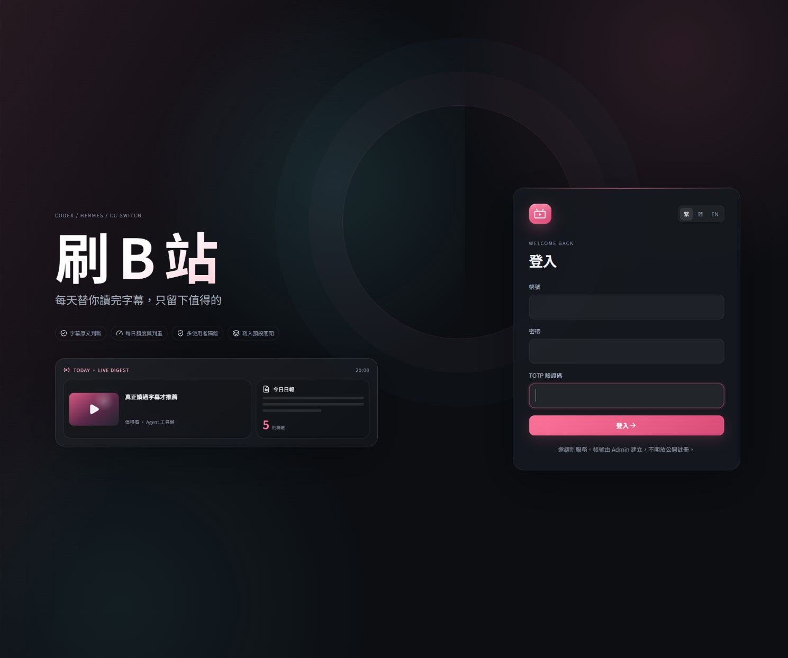
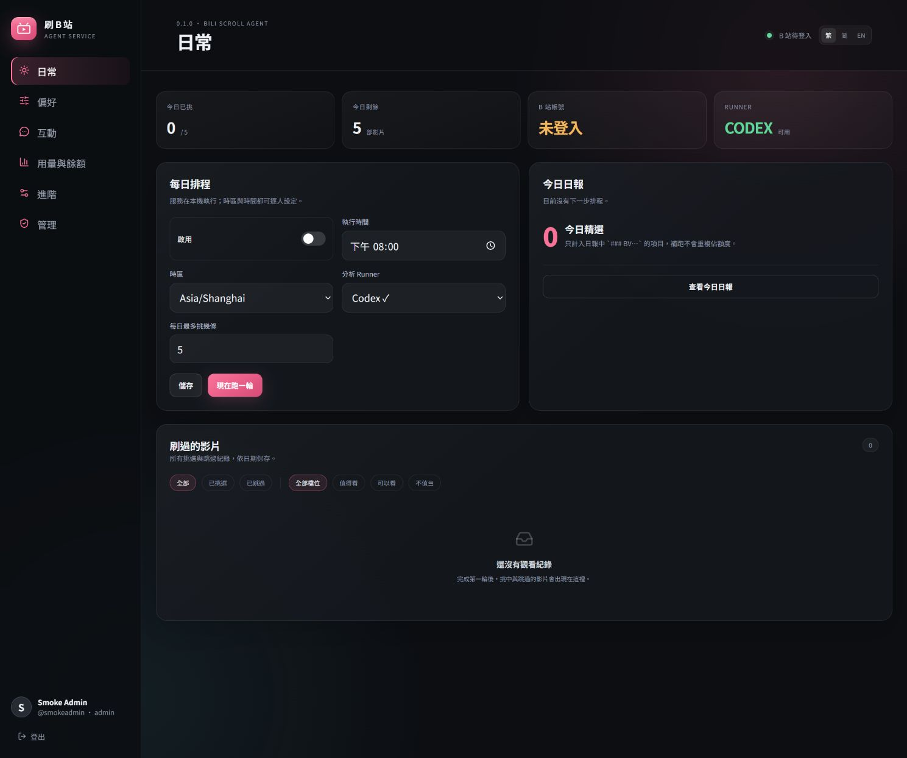

# Bili Scroll Agent

跨 Codex、Hermes Agent 與 cc-switch 的多使用者 B 站每日選題服務。

它保留 `dsh-bili-scroll` 的核心工作流，但不再依賴 DSH host：

- 用每位使用者自己的關鍵字搜尋近期 B 站影片。
- 必須讀字幕原文後才判斷內容是否值得看。
- 產生日報、判重紀錄與每月 archive，並執行每日額度。
- 可選自動收藏、公開評論、私信投遞、回覆與私信監聽。
- 同一份 Agent Skill + Streamable HTTP MCP 同時支援 Codex 與 Hermes。
- 支援 cc-switch 同步、provider/model 用量、token 成本與原生 DeepSeek 餘額查詢。
- 內建多租戶 WebUI、排程、Admin、稽核、邀請與 TOTP。

所有 B 站寫入預設關閉；評論、私信與 DM 監聽必須經 WebUI 密碼 + TOTP
step-up 才能開啟。

## 介面預覽





## 架構

| 元件 | 用途 |
|---|---|
| `server/` | FastAPI、SQLite、排程器、B 站 client、Agent runner、MCP |
| `web/` | React/Vite 回應式 WebUI |
| `plugins/bili-scroll-agent/` | 共用 Agent Skills 與 Codex plugin |
| `integrations/cc-switch/` | Codex/Hermes 共用 MCP 與 Skill 設定 |
| `deploy/` | Linux systemd、Caddy、安裝、備份與更新 |
| `scripts/local_usage_bridge.py` | 唯讀同步本機 cc-switch 歷史用量 |

服務預設使用 `127.0.0.1:8788`。這不與 deepseek-balance dashboard 常用的
`8787` 衝突。

## 本機啟動

需求：

- Python 3.12+
- `uv`
- Bun
- 若需要背景 agent 執行，VPS/主機需分別登入 Codex 或 Hermes

```powershell
uv sync --extra dev
cd web
bun install
bun run build
cd ..

copy .env.example .env
uv run bili-scroll create-admin
uv run bili-scroll serve
```

開啟 <http://127.0.0.1:8788>。首次登入需要 Admin CLI 建立的 TOTP。

也可以直接執行 `powershell -ExecutionPolicy Bypass -File scripts/start-dev.ps1`
完成同步、Bun 建置與啟動。

如果管理員遺失驗證器，或 TOTP secret 曾經外洩：

```powershell
uv run bili-scroll reset-totp --username <你的管理員帳號>
```

指令會輸出新的 secret 與 `otpauth://` URI，並撤銷該使用者既有的登入工作階段。

開發 WebUI：

```powershell
# terminal 1
uv run bili-scroll serve

# terminal 2
cd web
bun run dev
```

## Codex / Hermes / cc-switch

1. WebUI → 進階 → 建立 Agent 裝置權杖。
2. 在 cc-switch MCP 頁面貼上
   [`integrations/cc-switch/mcp-servers.json`](integrations/cc-switch/mcp-servers.json)
   的內容，替換 domain 與 token，並同時啟用 Codex、Hermes。
3. 在 cc-switch Skills → 倉庫管理加入此 repo，技能路徑填
   `plugins/bili-scroll-agent/skills`。
4. 新對話中執行 `$bili-scroll`（Codex）或 `/bili-scroll`（Hermes）。

詳細說明見
[`integrations/cc-switch/README.md`](integrations/cc-switch/README.md)。

## 模型、Provider 與成本

VPS 排程使用伺服器自己的 Codex/Hermes 安裝與 provider 憑證，不反向依賴
桌機 cc-switch 路由。每位 Member 可選 Codex 或 Hermes；Admin 可設定
provider、model、reasoning 與每日額度。

WebUI 的 **Usage & balance** 頁會顯示：

- 每次服務 run 的 provider/model、tokens 與可取得的成本。
- cc-switch 歷史 provider/model 用量與成本。
- cache hit rate。
- DeepSeek 原生官方 `/user/balance` 餘額。

### DeepSeek 餘額

這是本專案的原生功能，不需要額外 dashboard 才能使用。

Admin 可在 WebUI 保存 DeepSeek API key；也可在 systemd environment file
設定 `DEEPSEEK_API_KEY`。金鑰只會用於官方
`GET https://api.deepseek.com/user/balance`，以 AES-GCM 加密保存，
且永遠不會回傳到瀏覽器或 Agent context。

### 匯入 cc-switch 用量

```powershell
$env:BILI_SCROLL_SERVER = "http://127.0.0.1:8788"
$env:BILI_SCROLL_TOKEN = "bili_device_..."
py -3 scripts\local_usage_bridge.py
```

腳本以 SQLite read-only 模式讀取 `~/.cc-switch/cc-switch.db` 的
`usage_daily_rollups`。不上傳 provider API key、對話或 request body。

## 安全邊界

- Invite-only；Admin/Member 角色；24 小時單次邀請。
- 密碼 Argon2id，TOTP 必填；HttpOnly/SameSite session 與 CSRF。
- 每位使用者獨立 B 站 cookie、設定、排程、報告與 token。
- B 站 cookie、TOTP secret、provider key 使用 AES-GCM。
- MCP 只接受有效 Bearer token；run token 短效且只限該次 run。
- 模型永遠看不到 B 站 cookie、provider secret 或 run token。
- B 站字幕、留言、標題與私訊均視為不可信資料。

## 測試

```powershell
uv run pytest -q
uv run ruff check server tests scripts
cd web
bun run build
bun test
bun audit
```

真實 B 站登入仍需使用 WebUI QR 流程；倉庫測試不會發送任何評論或私信。

## Linux VPS

參見：

- [`deploy/install.sh`](deploy/install.sh)
- [`deploy/README.md`](deploy/README.md)
- [`deploy/bili-scroll.service`](deploy/bili-scroll.service)
- [`deploy/Caddyfile`](deploy/Caddyfile)
- [`deploy/env.example`](deploy/env.example)

安裝腳本使用 Bun。不會自動部署到未知主機。

## 授權

MIT。功能基準來自
[c1overzz/dsh-bili-scroll](https://github.com/c1overzz/dsh-bili-scroll)，
B 站整合基準包含 `adoresever/bilibili-mcp`。詳見 `NOTICE.md`。
